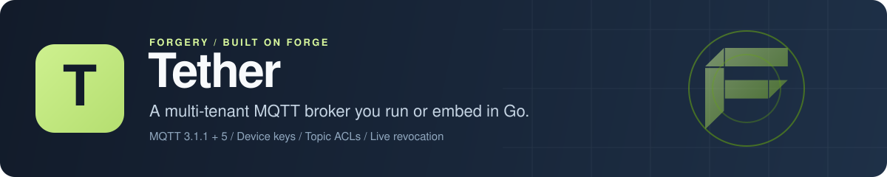

<p align="center">
  
</p>

# Tether: multi-tenant MQTT for Go

Tether is a multi-tenant MQTT broker for Go. Every client that connects is resolved to a tenant, devices sign in with [Keysmith](https://github.com/xraph/keysmith) keys, and [Warden](https://github.com/xraph/warden) roles decide which topics each one can publish and subscribe to. Client IDs and topics are namespaced per tenant on the server, so two of your customers can both use `sensors/pump-1/up` without ever seeing each other's messages, and revoking a key or narrowing a role takes effect on connections that are already open. You can run it as a single binary or mount it in your own [Forge](https://github.com/xraph/forge) app as an extension, with [mochi-mqtt](https://github.com/mochi-mqtt/server) doing the protocol work underneath.

[](https://go.dev/dl/) [](https://github.com/xraph/tether/actions/workflows/ci.yml)

[Quick start](#quick-start) · [Features](#why-tether) · [Tenants and devices](#tenants-devices-and-roles) · [JWT clients](#users-and-apps-over-jwt) · [Forge](#use-it-with-forge) · [Cells](#run-a-cell) · [Configuration](#configuration) · [Status](#status) · [FAQ](#faq)

Tether hasn't had a release yet. The broker runs on one node or as a cell of several, and its tests pass, so pin a commit until there's a tag.

## Quick start

You need [Go 1.26 or later](https://go.dev/dl/). Build the server and give it an admin token:

```bash
git clone https://github.com/xraph/tether.git
cd tether
go build -o tether ./cmd/tether
export TETHER_ADMIN_TOKEN="$(openssl rand -hex 32)"
./tether
```

That starts MQTT on port 1883 and the admin API on port 8080. Everything it stores goes under `./data`: a SQLite file for tenants, devices, keys and roles, and a Badger directory for sessions and retained messages. Ctrl-C shuts it down cleanly.

Forget the token and it won't start:

```text
tether: TETHER_ADMIN_TOKEN is empty: set it to a long random value, or pass --insecure-admin to leave the admin API and dashboard open
```

On a laptop, `--insecure-admin` is fine. On a server it hands every tenant to anyone who can reach port 8080.

Open a second terminal and export the same token there. Every admin call in this walkthrough is a POST with a JSON body, so a small helper keeps them short:

```bash
api() {
  curl -s -X POST "localhost:8080/tether/v1$1" \
    -H "Authorization: Bearer $TETHER_ADMIN_TOKEN" \
    -H 'Content-Type: application/json' -d "$2"
  echo
}

api /tenants '{"app_id":"aapp_demo","external_id":"acme","name":"Acme"}'
```

The `app_id` and `external_id` are yours. Together they map a Tether tenant to whatever your own system calls the customer. Put the `id` from the reply (it looks like `ttnt_01m5...`) in `TENANT_ID`, then create two roles and a device for each:

```bash
api /tenants/$TENANT_ID/roles '{"slug":"sensor","publish":["sensors/%c/up"]}'
api /tenants/$TENANT_ID/roles '{"slug":"monitor","subscribe":["sensors/+/up"]}'

api /tenants/$TENANT_ID/devices '{"name":"pump","client_id":"pump-1","roles":["sensor"]}'
api /tenants/$TENANT_ID/devices '{"name":"wall display","client_id":"display-1","roles":["monitor"]}'
```

`%c` expands to the client ID a device connects with, so the `sensor` role lets each pump publish to its own topic and nothing else. Each device reply carries a `username`, which is a Keysmith key ID (`akey_...`), and a `password`, which is the raw key (`tdk_live_...`). Copy both now, because this is the only time you'll see the password: put the pump's pair in `PUMP_USER` and `PUMP_PASS`, and the display's in `DISPLAY_USER` and `DISPLAY_PASS`. Tether keeps a hash, so a device that loses its key gets a new one from `POST .../devices/$DEVICE_ID/rotate`.

Now connect with any MQTT 3.1.1 or 5 client. With Mosquitto's tools, start the display in one terminal and publish from the pump in another:

```bash
mosquitto_sub -h localhost -i display-1 -u "$DISPLAY_USER" -P "$DISPLAY_PASS" -t 'sensors/+/up' -v
```

```bash
mosquitto_pub -h localhost -i pump-1 -u "$PUMP_USER" -P "$PUMP_PASS" -t sensors/pump-1/up -m 21.5
```

The display prints:

```text
sensors/pump-1/up 21.5
```

Topics are yours to name. Tether adds the tenant prefix on the way in and takes it off on the way out, which is why a second tenant can run its own `pump-1` on `sensors/pump-1/up` and neither side ever sees the other's traffic. While the broker is up, a few things are worth trying:

- Publish from the pump to `sensors/pump-2/up`. Its grant only covers its own client ID, so the message is dropped and counted in `forge_tether_acl_denials_total`. At QoS 1 or 2 a 3.1.1 client is disconnected, since that's the only refusal MQTT 3.1.1 has.
- Connect with the pump's key under a different client ID. The device is pinned to `pump-1`, so the CONNECT is refused.
- Revoke the display with `api /tenants/$TENANT_ID/devices/$DEVICE_ID/revoke '{}'`, using the `device.id` from its reply. Its open connection drops right away, not at the next reconnect.
- Publish over HTTP, for devices that can't speak MQTT. The payload is base64:

  ```bash
  curl -s -u "$PUMP_USER:$PUMP_PASS" -X POST localhost:8080/tether/v1/publish \
    -H 'Content-Type: application/json' \
    -d "{\"topic\":\"sensors/pump-1/up\",\"payload\":\"$(printf 22.0 | base64)\"}"
  ```

## Why Tether?

If you sell a connected product, sooner or later one broker carries traffic for many customers. The broker then has to know which customer each client belongs to, keep their topics apart, cut off a stolen device the moment you revoke it, and let each customer's admin see their own fleet and nobody else's. On a stock broker that tends to become an ACL file, a topic naming convention everyone has to remember, and a script that kicks clients when credentials change. In Tether the tenant is resolved when a client connects and stays attached to the connection, so every ACL check, rate limit and admin call already knows whose traffic it's looking at.

| You need | Tether gives you |
| --- | --- |
| Customers kept apart | Client IDs and topics namespaced per tenant on the server, invisible to clients, with a `$SYS` tree per tenant |
| Device credentials | Keysmith keys per device, stored hashed, with rotation, a grace window and revocation |
| Topic permissions | Warden roles with publish and subscribe filters, `%c` and `%u` placeholders, and inheritance through a parent role |
| Changes that take effect now | Revoking a key, narrowing a role or disabling a tenant reaches connections that are already open |
| People and services on the bus | Users and service accounts can connect with an [Authsome](https://github.com/xraph/authsome) JWT next to device keys |
| Per-tenant limits | Caps on connections, sessions and session expiry, and a publish rate with a burst |
| Sessions that survive a restart | Subscriptions, in-flight messages and retained messages persist in Badger on one node, or in NATS JetStream across a cell |
| More than one node | A cell of nodes over NATS JetStream: a client connects to any node, a node that dies has its sessions taken over and its wills published |
| Devices without MQTT | `POST /tether/v1/publish` with HTTP Basic auth, behind the same grants and rate limit |
| An admin API and a dashboard | A REST admin API for tenants, devices, roles, live clients, sessions and retained messages, and 24 [Forge dashboard](https://github.com/xraph/forge-dashboard) intents |
| Metrics | Connections, messages in and out, auth failures by reason and ACL denials by operation |

## Tenants, devices and roles

A tenant is the pair of `app_id` and `external_id` you gave it, plus a name, an `enabled` flag and its limits. Routes for devices, roles, clients and sessions take the tenant in the path, and anything that belongs to another tenant answers 404, never the other tenant's data. You can't delete a tenant while it still has devices.

A device is a Keysmith key with a name and a list of roles, which can be empty. It can also carry an expiry and a client ID pin. Pin your devices when you can. `%c` only keeps devices apart when they're pinned, because an unpinned device can connect with any client ID it likes, another device's included, so give unpinned devices grants on `%u` instead, which expands to the username (the key ID). A device with no role can connect, and that's all it can do.

A role has a slug, publish and subscribe filters, and an optional `parent_slug` whose grants it inherits. You list a tenant's roles with `GET .../roles`, replace a role's filters with `PUT .../roles/sensor/topics` (send both `publish` and `subscribe`, with `[]` for a list you want empty), and delete one with `DELETE .../roles/sensor` once no device holds it and no other role names it as a parent.

Tether listens to Keysmith and Warden, so the changes you make reach live connections:

| You do | Open connections |
| --- | --- |
| Revoke or delete a device | Disconnected straight away. A pinned device's session is deleted too, and an unpinned device's sessions run out on their expiry |
| Rotate a key with a grace window | Connections made with the old key end when the grace window closes. Connections made with the new key stay up |
| Narrow a role's topics | Subscriptions the device no longer has a right to are removed on the spot |
| Disable a tenant | Every connection of that tenant is closed |
| Change a tenant's limits | Applied from the next message |

Limits live on the tenant, under `limits`: `max_connections`, `messages_per_second`, `burst`, `max_session_expiry` and `max_sessions`. Zero means unlimited (for the session expiry, the broker's default), and in JSON the session expiry is a duration in nanoseconds. `max_sessions` counts open connections plus the sessions persistent clients left behind, so one tenant can't fill the node with offline sessions, though a device coming back to its own session is never refused by it. The message rate is per tenant per node. A tenant's `max_session_expiry` can only lower the broker's cap: a 5.0 client that asks for more is told the shorter value in its CONNACK, and a 3.1.1 persistent session simply gets the cap.

## Users and apps over JWT

Devices aren't the only clients. A person or a service account can connect with a JWT that Authsome issued, once you point Tether at Authsome's keys:

```yaml
tether:
  jwt:
    jwks_url: "https://auth.example.com/.well-known/jwks.json"
    issuer: "https://auth.example.com"
    audience: ["tether"]
    # algorithms: [RS256, EdDSA, ES256]   # the default
    # refresh_interval: 10m               # the default
    # leeway: 30s                         # the default, for nbf only
```

In your own app that's `extension.WithJWT(auth.JWTConfig{...})`. Leave the block out and only device keys connect.

The client sends the JWT as the MQTT password and the token's `sub` as the username. A password with three base64url segments that starts with `ey` goes to the JWT check and anything else goes to Keysmith, so one broker takes both. Tether checks the signature against the JWKS, then `exp`, `nbf`, `iss` and `aud`, and it checks `iss` and `aud` itself because Authsome's validator doesn't. HMAC algorithms and `alg: none` are refused. The leeway covers clock skew on `nbf` only, and a connection closes with reason code 0xA0 the moment its token expires.

The tenant comes from the token's `app_id` and `org_id`, the same pair a Keysmith key carries. Warden roles assigned to the user or service account decide the topics, `%u` expands to the `sub`, and a role change reaches the open connection the same way it does for a device.

Some tokens are refused on purpose: agents and workloads, tokens bound to a DPoP key (MQTT can't carry the proof), tokens issued to a third-party OAuth client (Tether can't enforce their scope), and delegated tokens with an `act` claim, since the subject's roles say nothing about someone acting for them.

Mind the Authsome side before you turn this on. Released Authsome versions don't put `org_id` on their tokens yet, and Tether refuses a token without it, with an error that names the claim. Your tokens also need an `iss` equal to `issuer` and an `aud` that names one of your `audience` values. Nothing on the Authsome side warns you when those are wrong, so all you'll see is Tether refusing the token as bad credentials. The HTTP publish endpoint stays device-only either way.

## Use it with Forge

The binary is a small Forge app, and you can build your own. The extension needs three things in the same app: a `*grove.DB` in the container, Keysmith and Warden. Tether registers a plugin with both so that key and role changes reach live connections, which means you build Keysmith and Warden through the extension's helpers:

```go
package main

import (
	"context"
	"log"

	"github.com/xraph/forge"
	"github.com/xraph/grove"
	"github.com/xraph/grove/drivers/sqlitedriver"
	keysmithext "github.com/xraph/keysmith/extension"
	"github.com/xraph/vessel"
	wardenext "github.com/xraph/warden/extension"

	"github.com/xraph/tether/extension"
	"github.com/xraph/tether/store/sqlite"
)

func main() {
	drv := sqlitedriver.New()
	if err := drv.Open(context.Background(), sqlite.DSN("./tether.db")); err != nil {
		log.Fatal(err)
	}

	db, err := grove.Open(drv)
	if err != nil {
		log.Fatal(err)
	}

	app := forge.New(forge.WithAppName("my-app"))

	// Keysmith, Warden and Tether all find this database in the container.
	if err := vessel.Provide(app.Container(), func() (*grove.DB, error) { return db, nil }); err != nil {
		log.Fatal(err)
	}

	t := extension.New(extension.WithAdminMiddleware(myAdminAuth))

	for _, x := range []forge.Extension{
		t.Keysmith(keysmithext.WithDisableRoutes()),
		t.Warden(wardenext.WithDisableRoutes()),
		t,
	} {
		if err := app.RegisterExtension(x); err != nil {
			log.Fatal(err)
		}
	}

	log.Fatal(app.Run())
}
```

`myAdminAuth` is a `forge.Middleware` of yours. Tether adds no admin authentication of its own, and `Start` fails with `ErrAdminAuthRequired` when the admin routes are on and you gave it neither a middleware nor `WithInsecureAdminRoutes()`. It also fails with `ErrKeysmithNotWired` or `ErrWardenNotWired` when Keysmith or Warden were built some other way. You can turn those two checks off with `WithoutKeysmithEvents()` and `WithoutWardenEvents()`, and the price is that live connections ignore key and role changes until they reconnect.

The grove database can be SQLite or PostgreSQL, and the extension picks the matching store from the driver name. It provides `*extension.Extension` to the container, and once it has started, `Broker()` and `Services()` hand you the broker and the services behind the REST API.

For the [Forge dashboard](https://github.com/xraph/forge-dashboard), the extension registers a contract contributor with 24 intents covering tenants, devices, roles and their topic grants, live clients, sessions and retained messages. Add `dashboard.NewExtension()` from `github.com/xraph/forge/extensions/dashboard` to serve it. Every intent answers `UNAUTHENTICATED` unless the request carries a signed-in user, and the dashboard's auth is off by default, so out of the box you'll see Tether's pages and their refusal. Turn the dashboard's auth on, or pass `WithInsecureDashboard()` if only people you trust can reach it.

A signed-in user only sees their own tenant: the one their session's `tenant_id` claim names if your auth provider sets it, otherwise the org of the Forge scope your auth middleware puts on the request (Authsome does this for you). Asking for another tenant gets `PERMISSION_DENIED`, and a session that names no tenant is refused outright. If your dashboard users run the whole node, pass `WithDashboardOperators()` or set `dashboard_operators: true`, and every signed-in user can reach any tenant and create, change and delete tenants.

Metrics go through the app's `forge.Metrics` and scrape from `/_/metrics` as `forge_tether_connections`, `forge_tether_messages_in_total`, `forge_tether_messages_out_total`, `forge_tether_auth_failures_total{reason}` and `forge_tether_acl_denials_total{op}`. A node in a cell adds `forge_tether_cluster_fenced`, `forge_tether_log_append_seconds`, `forge_tether_cas_lost_total` and `forge_tether_replay_messages_total`. None of them carry a tenant label.

## Run a cell

A cell is several Tether nodes that share sessions, QoS 1 and 2 messages, retained messages and shared subscriptions over [NATS JetStream](https://docs.nats.io/nats-concepts/jetstream). A device can connect to whichever node your load balancer picks and find its session there. A QoS 1 or 2 publish gets its PUBACK or PUBREC only once JetStream has stored it. When a node dies, the others notice after the lease runs out, publish the wills of the clients it held and take over its sessions as those clients reconnect.

You get the NATS underneath in one of two ways. In embedded mode each node runs its own NATS server, routed to the others, and there's nothing else to deploy. That's for cells of up to three nodes, and the binary refuses a bigger one. In external mode you run a NATS cluster (three or five JetStream servers) and the nodes connect to it, which is what you want in production and for anything past three nodes. Embedded mode stops at three because every broker restart would also be a JetStream peer leaving and joining, and you'd be cleaning that up by hand with a JetStream `peer-remove`.

### Three nodes on one machine

Each node needs its own HTTP, MQTT and route ports, so each gets its own config file. This loop writes all three, with every node routed to the other two:

```bash
for i in 1 2 3; do
  routes=""
  for j in 1 2 3; do [ "$j" != "$i" ] && routes="$routes\"nats://127.0.0.1:622$j\", "; done
  cat > node$i.yaml <<EOF
server:
  http_address: ":808$i"
tether:
  broker:
    tcp_address: ":188$i"
  cluster:
    enabled: true
    cell: demo
    embedded:
      cluster_name: demo
      cluster_listen: "127.0.0.1:622$i"
      routes: [${routes%, }]
EOF
done
```

Start each node in its own terminal, with the same `TETHER_ADMIN_TOKEN` in all three:

```bash
./tether --config node1.yaml --node-id n1
./tether --config node2.yaml --node-id n2
./tether --config node3.yaml --node-id n3
```

Give them a second or two between starts. The three share `./data/tether.db`, and SQLite won't let three processes switch a brand new file to WAL mode at the same moment. Don't leave it much longer than that, though: a node waits for the other two before it serves anything, because JetStream needs all three to place the cell's streams, and it gives up after about 30 seconds. Each node keeps its own JetStream data under `./data/nats/<node id>`. `--node-id` can also come from `TETHER_NODE_ID`.

Now run the [quick start](#quick-start) walkthrough against any node (change `8080` to `8081` in the `api` helper) and point the two clients at different nodes:

```bash
mosquitto_sub -h localhost -p 1883 -i display-1 -u "$DISPLAY_USER" -P "$DISPLAY_PASS" -t 'sensors/+/up' -q 1 -v
```

```bash
mosquitto_pub -h localhost -p 1881 -i pump-1 -u "$PUMP_USER" -P "$PUMP_PASS" -t sensors/pump-1/up -q 1 -m 21.5
```

The pump talks to node 1 and the display hears it on node 3. If you kill a node with `kill -9`, the other two declare it dead about 26 seconds later (the 24 second lease plus 2), then publish the wills its clients left.

The routes listen on loopback here, so nothing off the machine can reach them. If you bind `cluster_listen` (or the NATS client `embedded.listen`) to a real interface, Tether won't start until you either set `embedded.user` and `embedded.password`, the same pair on every node, or set `embedded.insecure: true`. Think hard before you pick the second one. Anyone who reaches an open route port can join the cell as a NATS server and read every tenant's traffic.

One catch with the binary: it keeps tenants, keys and roles in SQLite, and the nodes of a cell have to share them, so a cell of binaries lives on one host. To spread a cell across machines, mount the extension in your own app on PostgreSQL (see [Use it with Forge](#use-it-with-forge)) with the same `cluster:` block, or `extension.WithCluster(cluster.Config{...})` in code.

### NATS you run

```yaml
tether:
  cluster:
    enabled: true
    cell: prod
    mode: external
    urls: ["nats://nats-1:4222", "nats://nats-2:4222", "nats://nats-3:4222"]
    credentials: "/etc/tether/nats.creds"
```

You give every node the same block and its own ID. With `TETHER_NODE_ID` the file can be identical on every pod, and each pod sets the variable. On start, each node creates or updates the cell's streams and buckets (`TETHER_LOG_PROD`, `TETHER_CTL_PROD` and three KV buckets), with three replicas once NATS has three servers. Their subjects aren't namespaced by cell, so if you run more than one cell, give each its own NATS account.

`log_max_age` is how long JetStream keeps a QoS 1 or 2 message for a session that's offline, 7 days by default. Keep `broker.max_session_expiry` at or under it. A session that stays away longer still has its subscriptions when it comes back, but the messages older than the log's age are gone, and Tether logs a warning at start when the two don't line up.

A node that can't renew its lease for half of it fences itself: it drops its clients and refuses new ones until NATS answers again, so it never acts on sessions the rest of the cell may already have taken over. The extension's health check fails while that lasts, or while JetStream is out of reach, and it shows up in `/_/health`. `forge_tether_cluster_fenced` reads 1 at the same time.

## Configuration

The binary reads `--config <path>`, or `./tether.yaml` when that exists, and the defaults when it doesn't. A key you leave out keeps its default. [`tether.example.yaml`](tether.example.yaml) lists every key with a comment, and a test checks that it matches the defaults.

```yaml
server:
  http_address: ":8080"
  sqlite_path: "./data/tether.db"

tether:
  base_path: "/tether"
  broker:
    tcp_address: ":1883"
    websocket_address: ""
    data_dir: "./data/sessions"
    max_session_expiry: 168h
    max_packet_size: 1048576
    max_topic_length: 1024
    max_inflight: 1024
```

| Key | Default | What it does |
| --- | --- | --- |
| `server.http_address` | `:8080` | Admin API, device publish endpoint and dashboard contract |
| `server.sqlite_path` | `./data/tether.db` | Tenants, devices, keys and roles. The binary only does SQLite |
| `tether.base_path` | `/tether` | Prefix for every REST route |
| `tether.disable_routes` | `false` | Mounts no REST routes. The broker still runs |
| `tether.grove_database` | empty | Which grove database to use when the container holds more than one |
| `tether.dashboard_operators` | `false` | Makes every signed-in dashboard user an operator, with every tenant in reach |
| `tether.broker.tcp_address` | `:1883` | Plain MQTT. Empty turns it off |
| `tether.broker.tls` | off | MQTT over TLS: `address`, `cert_file` and `key_file` |
| `tether.broker.websocket_address` | off | MQTT over WebSocket, subprotocol `mqtt`, any path |
| `tether.broker.data_dir` | `./data/sessions` | Sessions, subscriptions, in-flight and retained messages. Empty keeps them in memory |
| `tether.broker.max_session_expiry` | `168h` | The longest session a client may ask for |
| `tether.broker.max_packet_size` | `1048576` | Largest MQTT packet, and the largest HTTP publish payload |
| `tether.broker.max_topic_length` | `1024` | A longer topic is refused with reason code 0x90 |
| `tether.broker.max_inflight` | `1024` | QoS 1 and 2 messages in flight per client, an offline session's queue included. Past it, messages for that client are dropped |
| `tether.jwt` | off | Authsome JWT clients. See [Users and apps over JWT](#users-and-apps-over-jwt) |
| `tether.cluster` | off | Run the node in a cell. See [Run a cell](#run-a-cell) and the commented block in [`tether.example.yaml`](tether.example.yaml) |

Environment variables aren't a config source, with two exceptions. `TETHER_ADMIN_TOKEN` is read from the environment and never from the file, so the secret stays out of anything you commit. `TETHER_NODE_ID` sets `tether.cluster.node_id`, and `--node-id` beats it. The `dashboard:` section of the same file belongs to the Forge dashboard.

In your own app the `tether:` block goes under `extensions.tether` (or a top-level `tether`) in the Forge config, and `WithConfig` and `WithBrokerConfig` layer over it.

## Status

Everything in [Why Tether?](#why-tether) works on one node and in a cell. What isn't there yet:

- More than one cell. A cell is one NATS deployment; spreading tenants over several cells comes later. Inside a cell, rate and connection limits still count per node.
- Per-tenant caps on retained messages and subscriptions. A tenant can hold as many of either as its devices' grants allow, bounded only by the packet and topic limits.
- Metering, entitlements and audit trails, then webhooks, outbound bridges, client certificate auth and MQTT 5 re-authentication.

We haven't run the Eclipse Paho interoperability suite against Tether yet. What we know about protocol behaviour comes from Tether's own tests, which run paho.mqtt.golang (3.1.1) and paho.golang (5.0) clients against a real broker. Those cover what Tether changes. They don't cover the corners of MQTT that mochi handles on its own.

## Documentation

There's no docs site for Tether yet. Every package with a public surface has an `llm.txt` that describes it in full, and they read fine for people too.

| If you want to | Read |
| --- | --- |
| Run the binary | [`cmd/tether/llm.txt`](cmd/tether/llm.txt), [`tether.example.yaml`](tether.example.yaml) |
| Call the admin API or the publish endpoint | [`api/llm.txt`](api/llm.txt) |
| Mount Tether in a Forge app | [`extension/llm.txt`](extension/llm.txt), [`extension/contract/llm.txt`](extension/contract/llm.txt) |
| Understand the broker's hooks and limits | [`broker/llm.txt`](broker/llm.txt), [`limits/llm.txt`](limits/llm.txt) |
| Run nodes as a cell | [`cluster/llm.txt`](cluster/llm.txt), [`extension/llm.txt`](extension/llm.txt) |
| Plug in device keys or JWTs | [`auth/llm.txt`](auth/llm.txt), [`events/llm.txt`](events/llm.txt) |
| Write topic grants | [`perm/llm.txt`](perm/llm.txt), [`acl/llm.txt`](acl/llm.txt), [`topic/llm.txt`](topic/llm.txt) |

## FAQ

### How do I keep MQTT tenants apart on one broker?

Create a tenant per customer and give each device a key under its tenant. Tether resolves the tenant when the client connects and namespaces its client ID and topics on the server, so a client can't reach another tenant's topics even with a `#` filter. Each tenant also gets its own `$SYS` tree, and mochi's global `$SYS/broker/...` is hidden from every client.

### What happens to a connected device when I revoke its key?

It's disconnected within moments, without waiting for it to reconnect. The same goes for deleting the device or disabling its tenant. If the device was pinned to a client ID, its session is deleted too.

### Does Tether support MQTT 5?

Yes. Clients can speak MQTT 3.1.1 or 5, over TCP, TLS or WebSocket. Topic aliases are the one feature turned off, so a client can't name a topic the ACL check never saw.

### Can I use Tether without Forge?

You can run the binary without writing any Forge code, since it's a Forge app built for you. To embed Tether in your own service, the extension is the supported path, and that needs Forge. The `broker` package also works on its own: `broker.New` takes any `auth.Authenticator` and `broker.PermLoader`, so you can start a broker on your own credentials and grants. You give up the REST API and the dashboard, and you call the broker's admin methods yourself when a key or a role changes.

### Does Tether cluster?

Yes. Nodes form a cell over NATS JetStream, either with NATS embedded in each node (up to three) or with a NATS cluster you run. A client can connect to any node of the cell. See [Run a cell](#run-a-cell).

### Where are device passwords stored?

Nowhere in plain text. Keysmith stores a hash of each key, and the raw key appears once, in the reply that creates or rotates the device. Admin routes never return it again.

## Contributing

Issues and focused pull requests are welcome on [GitHub](https://github.com/xraph/tether/issues). Run Go commands with `GOWORK=off` if a parent directory has a `go.work`:

```bash
GOWORK=off go test -race -count=1 ./...
golangci-lint run ./...
make check                                   # fmt, vet and lint
```

The PostgreSQL store tests skip unless `TETHER_TEST_POSTGRES` holds a DSN for a server where the role may create databases. [AGENTS.md](AGENTS.md) has the details, the lint rules and how to run those tests against a throwaway container. Commits follow [Conventional Commits](https://www.conventionalcommits.org/).

## License

MIT. See [LICENSE](LICENSE).

Tether is part of the [forgery stack](https://github.com/xraph/forge#the-forgery-stack) built on [Forge](https://github.com/xraph/forge), by [Rex Raphael](https://github.com/juicycleff) and [contributors](https://github.com/xraph/tether/graphs/contributors).
